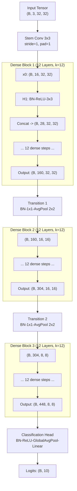

# DenseNet Architecture: One-Pager Technical Reference
**Course:** CS-320: Artificial Neural Networks & Deep Learning  
**Project:** P03 — Densely Connected Convolutional Networks (Huang et al., CVPR 2017)  
**Lead Author:** Mohammad Abdul Rehman (Team & Paper Lead)

---

## 1. Core Mathematical Concept: Feature Reuse vs. ResNet Summation

In standard residual networks (ResNet, He et al., 2016), each layer's transformation is combined with its input via additive identity skip connections:
$$\mathbf{x}_l = H_l(\mathbf{x}_{l-1}) + \mathbf{x}_{l-1}$$

While summation facilitates gradient backpropagation directly to earlier layers, it linearly superimposes representations, potentially destroying or diluting early low-level feature signals.

**DenseNet (Huang et al., 2017)** introduces direct connections from any layer to all subsequent layers within a dense block via **channel-wise concatenation**:
$$\mathbf{x}_l = H_l([\mathbf{x}_0, \mathbf{x}_1, \dots, \mathbf{x}_{l-1}])$$

Where:
- $[\mathbf{x}_0, \mathbf{x}_1, \dots, \mathbf{x}_{l-1}]$ represents the concatenation of the feature maps produced by all preceding layers in the block.
- If each composite function $H_l$ produces $k$ feature maps, the input to the $l$-th layer has:
  $$C_{\text{in}}(l) = k_0 + k \times (l - 1)$$
  channels, where $k_0$ is the number of feature maps entering the block, and $k$ is the **growth rate**.

```
Standard ResNet:    x_0 ───(+)───> x_1 ───(+)───> x_2  (Additive summation)
                             │              │
                           H_1(x_0)       H_2(x_1)

DenseNet:           x_0 ───┬───────┬───────> [x_0, x_1, x_2] (Direct feature reuse)
                           │       │               ▲
                           ▼       │               │
                         H_1 ───> x_1 ───┬─────────┤
                                         │         │
                                         ▼         │
                                       H_2 ─────> x_2
```

---

## 2. Macro-Architecture & Tensor Flow (DenseNet-40 on CIFAR-10)

DenseNet-40 ($k=12$, no bottleneck) comprises:
1. **Initial Stem Conv:** $3 \times 3$ Conv, stride 1, $C=16$ ($k_0=16$).
2. **Dense Block 1:** $L=12$ layers ($H_l = \text{BN} \rightarrow \text{ReLU} \rightarrow 3\times 3\text{ Conv}$). Channel progression: $16 \rightarrow 28 \rightarrow 40 \rightarrow \dots \rightarrow 160$.
3. **Transition Layer 1:** $\text{BN} \rightarrow 1\times 1\text{ Conv} \rightarrow 2\times 2\text{ AvgPool}$ (stride 2). $\theta=1.0 \implies 160 \rightarrow 160$, spatial $32 \times 32 \rightarrow 16 \times 16$.
4. **Dense Block 2:** $L=12$ layers. Channel progression: $160 \rightarrow 172 \rightarrow \dots \rightarrow 304$.
5. **Transition Layer 2:** $\text{BN} \rightarrow 1\times 1\text{ Conv} \rightarrow 2\times 2\text{ AvgPool}$ (stride 2). $304 \rightarrow 304$, spatial $16 \times 16 \rightarrow 8 \times 8$.
6. **Dense Block 3:** $L=12$ layers. Channel progression: $304 \rightarrow 316 \rightarrow \dots \rightarrow 448$.
7. **Classification Head:** $\text{BN} \rightarrow \text{ReLU} \rightarrow \text{GlobalAvgPool} \rightarrow \text{Linear}(448 \rightarrow 10)$.



### Tensor Dimensions Summary Table
| Stage / Layer | Feature Dimension $(C \times H \times W)$ | Channels In ($C_{\text{in}}$) | Channels Out ($C_{\text{out}}$) | Note |
|---|---|---|---|---|
| Input Image | $3 \times 32 \times 32$ | - | 3 | CIFAR-10 RGB |
| Stem Conv | $16 \times 32 \times 32$ | 3 | 16 | $k_0 = 16$ |
| Dense Block 1 (L=12) | $160 \times 32 \times 32$ | 16 | 160 | Concatenates $12 \times 12 = 144$ maps |
| Transition 1 | $160 \times 16 \times 16$ | 160 | 160 | $2\times 2$ AvgPool (stride 2) |
| Dense Block 2 (L=12) | $304 \times 16 \times 16$ | 160 | 304 | Concatenates $12 \times 12 = 144$ maps |
| Transition 2 | $304 \times 8 \times 8$ | 304 | 304 | $2\times 2$ AvgPool (stride 2) |
| Dense Block 3 (L=12) | $448 \times 8 \times 8$ | 304 | 448 | Concatenates $12 \times 12 = 144$ maps |
| Global Avg Pool | $448 \times 1 \times 1$ | 448 | 448 | Spatial collapse to vectors |
| Classifier | $10$ | 448 | 10 | Class logits |

---

## 3. Key Hyperparameters Explained

| Parameter | Standard Value | Architectural Role | Impact of Live Change |
|---|---|---|---|
| **Growth Rate ($k$)** | 12 (or 32, 48) | Number of channels each layer outputs ($H_l$). Controls rate of information flow into collective knowledge. | **Increasing $k$:** Parameter count scales quadratically within blocks; GPU activations increase dramatically. Performance improves up to a capacity limit. |
| **Bottleneck (DenseNet-B)** | True ($4k$) | Injects $1\times 1$ Conv ($\text{BN}\rightarrow\text{ReLU}\rightarrow\text{1x1 Conv}$) compressing $C_{\text{in}}$ down to $4k$ before costly $3\times 3$ Conv. | **Disabling bottleneck:** $3\times 3$ convolution parameters scale as $9 \times C_{\text{in}} \times k$. For deep networks where $C_{\text{in}} > 1000$, parameters explode without bottleneck. |
| **Compression ($\theta$, DenseNet-C)** | 0.5 (in BC) | In transition layers, outputs $\lfloor \theta \cdot m \rfloor$ channels instead of $m$. | **Setting $\theta=1.0$ (no compression):** Transitions retain all accumulated channels, increasing FLOPs and classifier head size by $\sim 2\times$. |
| **Dropout ($p$)** | 0.2 (no-aug) / 0.0 (aug) | Injected immediately following each $3\times 3$ convolution layer. | Used when data augmentation is disabled to prevent overfitting; redundant when strong translation/flip augmentation is present. |

---

## 4. Strengths & Trade-offs

### Strengths
1. **Strong Gradient Backpropagation:** Every layer has direct gradient paths to the input and loss, resolving vanishing gradients without requiring extreme width.
2. **Substantial Parameter Efficiency:** Because early features are explicitly reused, layers do not need to relearn redundant feature detectors. DenseNet-BC achieves state-of-the-art accuracy with fewer parameters than equivalent ResNets.
3. **Implicit Deep Supervision:** Early layers receive supervision gradients directly from the loss via short paths through concatenation.

### Weaknesses / Practical Challenges
1. **GPU Memory Footprint During Training:** Channel concatenation creates numerous distinct tensor allocations. Even though parameters are small, activations can cause Out-Of-Memory (OOM) errors during backprop if gradient checkpointing or memory-efficient implementations are not utilized.
2. **Memory Bandwidth Bottleneck:** High memory-access cost (MAC) from frequent tensor concatenations can result in slower wall-clock throughput on GPUs compared to ResNets despite fewer FLOPs.

---

## 5. Architectural Self-Check Questions

Test your understanding before the viva:

1. **Question 1:** In DenseNet-40 ($k=12$, no bottleneck), what is the exact number of input channels to the 7th layer of DenseBlock 2?
2. **Question 2:** Why does a DenseNet require Transition Layers between Dense Blocks rather than connecting all layers in the network into a single monolithic dense block?
3. **Question 3:** What is the exact parameter count formula for a DenseNet-B bottleneck layer with $C_{\text{in}}$ inputs, $1\times 1$ bottleneck producing $4k$ channels, and $3\times 3$ conv producing $k$ channels (including Batch Normalization with affine parameters)?

<details>
<summary><b>Click to Reveal Answers</b></summary>

### Answers:

1. **Answer 1: 232 channels.**  
   *Reasoning:* Dense Block 1 outputs $16 + 12 \times 12 = 160$ channels. Transition 1 ($\theta=1.0$) preserves $m=160$ channels. Dense Block 2 starts with $k_0 = 160$. Layer $l=7$ receives $C_{\text{in}}(7) = k_0 + (7 - 1) \times k = 160 + 6 \times 12 = 160 + 72 = 232$ channels.

2. **Answer 2: Spatial Downsampling Incompatibility.**  
   *Reasoning:* Direct concatenation $[\mathbf{x}_0, \mathbf{x}_1, \dots, \mathbf{x}_{l-1}]$ strictly requires all tensors to share the exact same spatial dimensions $(H \times W)$. Downsampling feature map sizes (via pooling or strided convolutions) is essential for computer vision architectures to expand receptive fields and reduce computational cost. Therefore, dense concatenation is strictly partitioned into Dense Blocks of constant spatial size, separated by Transition Layers where pooling and channel compression occur.

3. **Answer 3: Formula:**  
   $$\text{Total Params} = \underbrace{2 C_{\text{in}}}_{\text{BN}_1} + \underbrace{C_{\text{in}} \cdot 4k}_{\text{Conv } 1\times 1} + \underbrace{2 \cdot 4k}_{\text{BN}_2} + \underbrace{4k \cdot k \cdot 9}_{\text{Conv } 3\times 3} = 2 C_{\text{in}} + 4k C_{\text{in}} + 8k + 36k^2$$
   *(Note: Batch Normalization includes $\gamma$ and $\beta$, equaling $2 \times C$ learnable parameters. Convolutions in pre-activation DenseNet have no bias terms because following BN absorbs the bias).*
</details>
